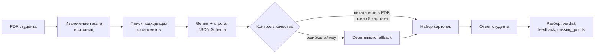

# AI-блок Demo Day: как работают карточки

Материал рассчитан на один слайд и объяснение за 1,5–2 минуты. Цифры ниже имеют ссылки на воспроизводимые артефакты; разные наборы данных не выдаются за одну непрерывную метрику.

## Схема для слайда

Что сказать: «Модель не получает весь пользовательский аккаунт и не действует как агент. Для генерации она видит выбранные фрагменты документа, а для проверки — одну карточку и один ответ. После Gemini приложение проверяет структуру, число карточек и дословное наличие каждой цитаты в источнике. При отказе провайдера включается локальный алгоритм, а студент всегда может свериться с цитатой».

## Цифры по этапам семестра

| Этап | Что измерялось | Результат | Что это доказывает |
|---|---|---:|---|
| Lab3 | Контракт и grounding baseline | 100% schema pass и 100% grounded-card на проверенном baseline | UI получает структуру, цитаты существуют в источнике; это не оценка полезности формулировок |
| Lab4 | Сравнение алгоритмов review на 40 одинаковых кейсах | 82,5% → 90,0%, +7,5 п.п. | Нормализация смысла лучше сырого lexical overlap |
| Lab5 | Ручное совместное ревью 20 deterministic-разборов | 80% → 100% без противоречий; 35% → 100% полноты | Исправлены ложные пропуски и непонятные объяснения |
| Lab6 rehearsal | 5 публичных кейсов × 3 повтора | 15/15 контрактов прошли, все исходы стабильны, Gemini без fallback | Выбранные кейсы воспроизводятся на публичном снимке |

Источники: `docs/acceptance-notes-lab3.md`, `docs/experiments/lab4.md`, `docs/quality/lab1-ai-evidence-review-v5.md`, `artifacts/demo/lab6-ai-demo-run.json`.

## Главное решение ablation

На 42 frozen review-кейсах полный набор смысловых правил дал **92,86%**. Без phrase aliases и без contradiction guard результат снижался до **88,10%** (−4,76 п.п.), а сырой lexical overlap — до **71,43%** (−21,43 п.п.). Поэтому оставили не «совпадение слов», а связку:

1. нормализация и смысловые эквиваленты (`RAM` = «оперативная память»);
2. проверка противоречий («жёсткий диск» не принимается вместо RAM);
3. точная опора на эталон и цитату.

Это лучший инженерный вывод ablation: структурированный ответ модели важен, но качество разбора удерживают явные смысловые ограничения. Полный источник — `artifacts/experiments/lab5-ablation-results.json`.

## Честное ограничение

Публичная репетиция tagged candidate прошла 15/15, но задержка была нестабильна: медиана **8,852 с**, p95 и максимум **20,393 с**. После обновления production отдельный smoke дал 4/5 через Gemini; одна генерация завершилась fallback после **61,636 с**, а p95 четырёх успешных Gemini-вызовов составил **29,184 с**. Поэтому live-вызов нельзя считать гарантированно быстрым. Команда согласовала единый порог: через **30 секунд** переходим на заранее записанный ответ и прямо называем его бэкапом. Изображение без текстового слоя также требует OCR и не покрывается этим модельным прогоном.
