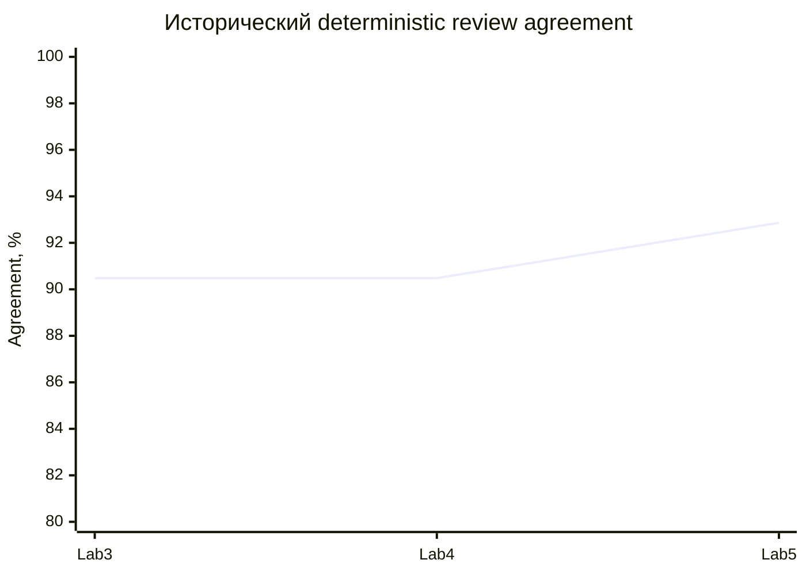

# Почему нам можно верить

Мы проверяем структуру ответа и цитаты по загруженному материалу, сохраняем результаты и запускаем автоматические тесты, в том числе проверки безопасности. На версии `v0.5.9-integrated-candidate` прошли [release quality gates](https://github.com/vstu-sii/kartochki-dlya-povtoreniya-iz-konspekta-4rnb/actions/runs/40598174350) и [integrated quality](https://github.com/vstu-sii/kartochki-dlya-povtoreniya-iz-konspekta-4rnb/actions/runs/40598174379): они используют детерминированный режим.

Реальный Gemini в Lab5: 36/42 = 85,71% по исходным оценкам; 39/42 = 92,86% после согласования трёх эталонов на тех же ответах. Это не два новых прогона. Подробности и ограничения — `docs/quality/live-provider-verification-2026-10-28.md`.

Мы не гарантируем истинность исходного PDF и скорость в каждом запросе: последний публичный p95 31,990 с на пяти ответах. Перед демо нужно подтвердить SHA, запустить gates на окончательном теге и повторить атаку на входы демонстрации.

## Динамика качества за семестр

Исторические deterministic-прогоны с прежней разметкой: Lab3 — 90,48%, Lab4 — 90,48%, Lab5 — 92,86%. Это динамика локального алгоритма, а не живого Gemini. Источник: [финальный отчёт Lab5](../quality/final-quality-report.md), раздел «Историческая динамика» и приведённые там артефакты.

| Измерение | Результат | Граница вывода |
|---|---|---|
| Исторический deterministic Lab3 / Lab4 / Lab5 | 90,48% / 90,48% / 92,86% | Только серия на графике |
| Живой Gemini Lab5, исходные эталоны | 36/42 = 85,71% | Отдельный live-поднабор |
| Те же ответы после пересмотра трёх эталонов | 39/42 = 92,86% | Переоценка, не улучшение модели |

## Новые доказательства команды на 29.10.2026

По [протоколу AI](https://github.com/vstu-sii/kartochki-dlya-povtoreniya-iz-konspekta-4rnb/blob/81a3f46f493090f5ed4d659dc772508e42e91a8e/docs/demo-run.md): 5 кейсов × 3 публичные попытки, 15/15 прошли проверки, fallback_used=false; median 8,852 с, p95/max 20,393 с. [Сырые результаты](https://github.com/vstu-sii/kartochki-dlya-povtoreniya-iz-konspekta-4rnb/blob/81a3f46f493090f5ed4d659dc772508e42e91a8e/artifacts/demo/lab6-ai-demo-run.json), [ноутбук](https://github.com/vstu-sii/kartochki-dlya-povtoreniya-iz-konspekta-4rnb/blob/81a3f46f493090f5ed4d659dc772508e42e91a8e/notebooks/lab6_demo_cases.ipynb). Это полученные доказательства AI, не новый независимый прогон Quality. В протоколе указан SHA прода 1b320e130100eff40088e2b5e6e741bc04d379c5. Выборка включает генерацию и review, поэтому её p95 нельзя напрямую сравнивать с review p95 31,990 с на пяти ответах Lab5 или считать доказательством ускорения. Цель review ≤7 с не подтверждена.

## Ограничения для слайда доверия

- Формат и наличие цитаты проверяются; истинность исходного PDF не гарантируется.
- Полезность Lab5: 2/3 событий = 66,67% при цели ≥80%; выборка мала и включает смену оценки и smoke.
- X-User-ID не является полноценной аутентификацией: риск подмены пользователя остаётся высоким.
- 17/17 security — ограниченный набор обработчиков с подменой модели; бинарный PDF и полный публичный путь не покрыты.
- Финальный командный фриз и gates на назначенной демо-версии ещё не подтверждены.

Полные [риски безопасности](../quality/final-security-report.md), [результаты качества](../quality/final-quality-report.md), [чеклист и зависимости](quality-status.md).
