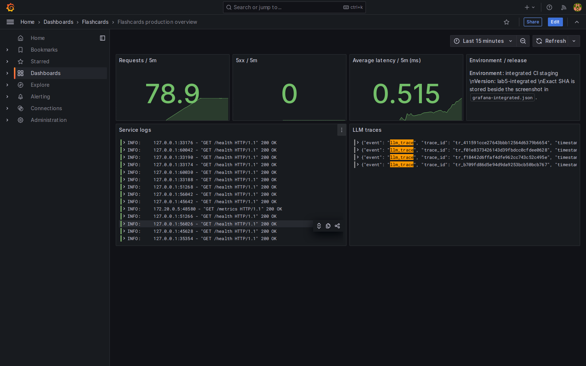

# Проверка передачи Delivery и Gemini — 27.10.2026

**Ветка сдачи Quality: `lab5-quality-testing`.** Материалы из интеграционной ветки перенесены сюда отдельными файлами без merge чужого кода. Источник: `lab5-integrated-quality`, SHA `4098c5c1672edb99089cb1c3e9800e9383444fc3`. Эта ветка использована для передачи/интеграции; она не заменяет ветку роли по заданию. PR не создавался.

## Подтверждено независимо

| Пункт | Результат |
|---|---|
| Скрин дашборда | **Закрыт**: визуально просмотрен реальный Grafana screenshot; ci-staging, последние 15 минут, время 27.10.2026 20:47:50 МСК, SHA в соседнем JSON. Это тестовые запросы, не production uptime. |
| Полный eval на общей версии | **Закрыт для тега-кандидата** `v0.5.3-quality-candidate` → `85b546e20f54a97f11dea1ac295e679902fc2b46`. GitHub API подтвердил success, head_sha и событие push. Артефакт скачан и проверен: passed=true, 8/8 групп, 132/132, 62 unit/integration-теста. |
| Включение исправлений | Git ancestry подтвердил, что тег включает AI 9d29cf2 и Quality 9685b3e. Отчёты этого обновления созданы позже и в неизменяемый тег не входят. |
| Публичная версия | Независимый GET /health вернул 200 и SHA 85b546e, совпадающий с тегом. |
| Обычный PDF → Gemini → БД | Переданные сырые ответы подтверждают 1 генерацию и 5 разборов, все 6 без fallback, генерация 201, reviews 200/persisted=true/review_id, повторное открытие 200 и 5 карточек. Платный сценарий заново не запускался. |
| Стоимость | **Частично**: 2208 input + 764 output, по видимым счётчикам $0.0025724. Полная стоимость не подтверждена: thinking tokens не показаны. |

[Проверенный CI](https://github.com/vstu-sii/kartochki-dlya-povtoreniya-iz-konspekta-4rnb/actions/runs/40554481097), [протокол проверки](../../artifacts/quality/lab5-delivery-verification-2026-10-27/verification.json), [релизный результат из CI](../../artifacts/quality/lab5-delivery-verification-2026-10-27/release-artifact/evals/lab5-release-results.json), [лог 62 тестов](../../artifacts/quality/lab5-delivery-verification-2026-10-27/release-artifact/evals/unit-and-integration.log).

[Метаданные скрина](evidence/lab5/grafana-integrated.json). Панель 5xx=0 не доказывает отсутствие ошибок всей системы: Delivery описывает также frontend 503, не захваченные этой панелью. Подпись средней задержки не превращает значение панели в p95 Gemini.

## Пересчёт Gemini

Модель фактических вызовов `gemini-3.5-flash-lite`, промпты cards-v2.1/review-v2.1; на стенде она назначена основной через конфигурацию. Сценарий измерен 27.10.2026 21:17:50 МСК. Исторические 503/429 не удалены, но утверждение «нет ни одного успешного полного Gemini-сценария» больше не актуально.

Генерация: **5916 мс wall-clock** (n=1), 2374 мс в поле model latency. Разборы wall-clock: 21496, 5429, 3387, 4371, 13057 мс. Пересчёт nearest-rank: **p50 5429 мс, p95 21496 мс** (n=5). Это малая выборка; стабильную оценку нагрузки не даёт. Цель генерации <60 с достигнута в этой пробе, цель разбора ≤7 с — **не достигнута**. Поле latency_ms нельзя подставлять вместо пользовательского wall-clock.

Сумма usage сверена по всем шести вызовам. Стоимость видимых токенов: `2208/1e6 × 0.30 + 764/1e6 × 2.50 = $0.0025724`. [Официальный тариф](https://ai.google.dev/gemini-api/docs/pricing) включает thinking tokens в цену output. Поэтому эта сумма — расчёт по доступным счётчикам, не полный счёт и не доказанное списание. `budget_usd_per_scenario=0.10` из переданного JSON не прослеживается до согласованного бюджета: model-candidates.md описывает план $0.02625 для генерации + 10 разборов на другой модели. Новая проба содержит 5 разборов. Флаг within_budget=true принят только как исходное заявление, не итоговый вердикт Quality.

[Сырые ответы Gemini](../../artifacts/quality/lab5-production-final/gemini-live-20261027.json), [исходный handoff](delivery-quality-handoff.md).

## Что остаётся

1. **Полная стоимость:** AI/Delivery передают полный usageMetadata (thinking/total tokens, а при наличии повторов — учёт всех платных вызовов), фактический тариф и обоснованный бюджет для одинакового объёма сценария. Доступ к ключу Quality не нужен.
2. **Не достигнутые цели:** полезность пока 66,67% <80%; новый wall-clock p95 разбора 21,496 с >7 с. Улучшить и перемерить либо оставить честными ограничениями. Полезность новой технической проверкой не измерялась.
3. **Формулы в live Gemini:** по handoff был gemini_invalid_output с переходом на fallback. Локальное сохранение 39/39 остаётся подтверждённым, но не доказывает provider-режим.
4. **Production logs:** полный просмотр интервала на MODEL_OUTPUT_INVALID пока не передан. Успешные ответы не доказывают отсутствие ошибок за весь период.

Дополнительный integrated run 40554480687 был красным (привязка к тегу); исправление workflow находится после тега. Он не выдан за зелёный и не отменяет независимо проверенный успешный основной release-quality run 40554481097. Прежние теги не перемещались, новых тегов в ходе этой проверки не создавалось.
