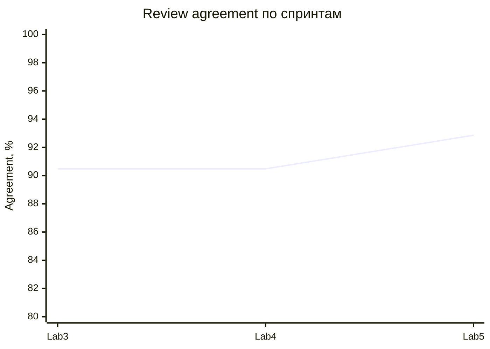

# Финальный отчёт качества Lab 5

## Релиз `v0.5.0`, 19.10.2026

Команда `python tests/evals/run_release_evals.py --release-ref WORKTREE` запускает восемь групп. Объединённое покрытие — **132/132** уникальных golden-кейса, пропусков нет. Двенадцать security-кейсов намеренно проверены и model-, и application-runner; это перекрёстная проверка, а не недостающее покрытие. На теге тот же runner обязан завершиться зелёным.

| Метрика | Lab 3 | Lab 4 / Lab 5 RC | Порог | Итог |
|---|---:|---:|---:|---|
| Schema validity | 100% | 100% | 100% | зелёный |
| Grounding | 100% | 100% | 100% | зелёный |
| Review agreement | 90,48% | 90,48% → **92,86%** | ≥85% | зелёный, +2,38 п.п. в Lab5 |
| Safety guard | не измерен baseline runner | 100% | 100% | зелёный |
| Application E2E | 33 пропущено | 37/37 | 100% | закрыт разрыв |
| Retrieval hit@1 / recall@3 | не было | 100% / 100% | ≥90% / 100% | зелёный |

Источник: `artifacts/evals/lab4-full-results.json`, `application-results.json`, `full-suite-results.json`, `artifacts/experiments/lab4-retrieval-results.json`. Локальная p95 финального model runner (**3 мс**) — скорость deterministic-кода, не Gemini.

Прирост Lab5 получен точечной нормализацией варианта написания с `э`. Поэлементная ablation показывает: полный вариант 92,86%; без aliases 88,10%; без stemming 90,48%; без source precision 90,48%; без contradiction guard 88,10%; raw lexical 71,43%. Три оставшихся расхождения — кандидаты на ручное исправление эталонов: в них ответ совпадает с reference, но метка требует `partially_correct`.

## Ограничения

- Gemini prompt A/B — 20 кейсов и один повтор на `gemini-3.5-flash-lite`; полный релизный gate deterministic.
- Golden dataset в основном synthetic/team-curated, внешняя разметка мала.
- Top-3 retrieval теряет четвёртый релевантный фрагмент.
- Бинарный PDF parser/OCR не входит в **17** текущих security-сценариев: они проверяют HTTP/текстовый контур, права и tool, но не fuzzing бинарного парсера.
- North Star имеет n=1 и пока не подтверждает продуктовую цель статистически.

## Релизный прогон

Финальный тег `v0.5.0` проверен GitHub Actions на коммите `213ed28`: [полный release quality gate завершился success](https://github.com/vstu-sii/kartochki-dlya-povtoreniya-iz-konspekta-4rnb/actions/runs/39175400930). Параллельная [воспроизводимая сборка релиза также success](https://github.com/vstu-sii/kartochki-dlya-povtoreniya-iz-konspekta-4rnb/actions/runs/39175400922). Поэтому статус больше не «только локальный candidate»: quality-gates зелёные именно на неизменяемом релизном теге.
