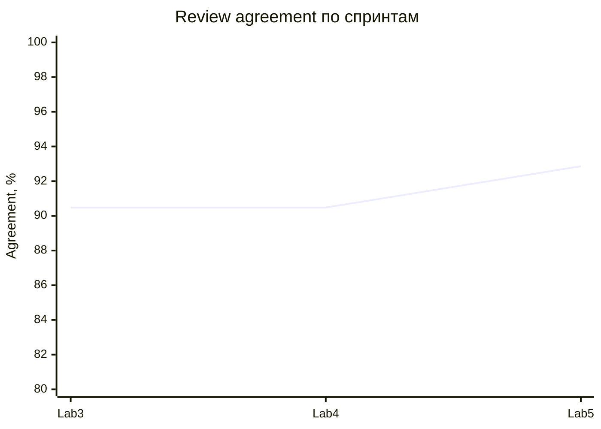

# Финальный отчёт качества Lab 5

**Актуализация после синхронизации ролей:** [проверка 27.10](role-sync-verification-2026-10-27.md). Общий локальный код cards-v2.3: 8/8, 132/132, 70 тестов. Последний проверенный production/тег — v0.5.8 / 5504ef5; он ещё не содержит новый промпт. Стоимость e88 $0.003179 включает thinking и укладывается в $0.04; p95 пяти разборов 12,582 с >7 с. Три новых настоящих перефразирования прошли без fallback; полный live golden не выполнен. Нижележащие прежние статусы и цифры — история соответствующих версий, а не утверждения о новом коде.

## Общий кандидат после объединения ролей

Тег `v0.5.7-integrated-candidate`, SHA `e88d97206ce6e0f073e70affff99c63582bebfc4`, включает AI `042ec47` и Quality `7b0d3ce`. На теге прошли [release quality gates](https://github.com/vstu-sii/kartochki-dlya-povtoreniya-iz-konspekta-4rnb/actions/runs/40570209570), [сборка](https://github.com/vstu-sii/kartochki-dlya-povtoreniya-iz-konspekta-4rnb/actions/runs/40570209575) и [integrated quality](https://github.com/vstu-sii/kartochki-dlya-povtoreniya-iz-konspekta-4rnb/actions/runs/40570209650). Gate deterministic, а не полный live eval Gemini.

В живой проверке этого SHA обычный PDF и пять разборов прошли на Gemini без fallback; generation trace_id присутствует. На формульном PDF следующий сценарий перешёл на fallback `gemini_invalid_output`, поэтому серия из трёх сценариев прервана после одного успешного. Пять разборов дали p95 nearest-rank 12,582 с, что выше целевых 7 с; n=5 не даёт устойчивой оценки. [Сырые измерения и статус](../../artifacts/quality/lab5-production-final/gemini-live-e88.json). Формулы, стабильность Gemini, качество свободных ответов и p95 остаются открытыми для дальнейшей проверки; зелёный deterministic gate их не закрывает.

## Новые данные интеграции

Quality `7b0d3ce` и AI `042ec47` объединены в общую ветку, включая `cards-v2.2` и trace_id генерации. Локальный полный gate после объединения: 8/8 групп, 132/132 уникальных кейса; это deterministic, не live Gemini. На предыдущем live кандидате `b959a4a` трёх полных сценариев и 15 разборов было недостаточно для выполнения цели p95 ≤7 с: измерено 29,070 с, четвёртая генерация завершилась fallback. Измерение [сохранено](../../artifacts/quality/lab5-production-final/gemini-minimal-b959.json). Новые AI-изменения и промпт требуют отдельного релизного тега, CI и живого замера на том же SHA; достижение цели пока не подтверждено.

## Актуальное объединение AI, Quality и Delivery — 27.10.2026

На интегрированном теге `v0.5.5-integrated-candidate` и SHA `bc56b605aaa7a9781fefd1bc576eb0d59bb20301` [полный release quality gate](https://github.com/vstu-sii/kartochki-dlya-povtoreniya-iz-konspekta-4rnb/actions/runs/40563748484) и [сборка](https://github.com/vstu-sii/kartochki-dlya-povtoreniya-iz-konspekta-4rnb/actions/runs/40563748214) прошли; JSON и логи находятся в артефактах запусков. Автоматический gate использует deterministic-модель. Результаты прежнего тега ниже сохранены как история.

Дополнительно на публичном стенде этого SHA выполнены два сценария с формульным PDF и десять разборов через `gemini-3.5-flash-lite` без fallback: p95 загрузки и генерации 3,757 с (n=2), p95 разбора 9,414 с (n=10); nearest-rank. Цель разбора ≤7 с в этом небольшом замере не достигнута, устойчивость p95 на такой выборке ограничена. [Сырые данные](../../artifacts/quality/lab5-production-final/gemini-formula-bc56.json). Эти данные не заменяют полную ручную оценку качества Gemini и не подтверждают устойчивую работу на любых PDF.
Предыдущая проверенная общая версия Quality: v0.5.3-quality-candidate / 85b546e, полный CI 132/132 и 62 теста. [Свидетельства Delivery/Gemini и остаток](delivery-verification-2026-10-27.md). Ниже сохранена динамика и история прежних версий.

## Релиз `v0.5.1`, 19.10.2026

Команда `python tests/evals/run_release_evals.py --release-ref WORKTREE` запускает восемь групп. Объединённое покрытие — **132/132** уникальных golden-кейса, пропусков нет. Двенадцать security-кейсов намеренно проверены и model-, и application-runner; это перекрёстная проверка, а не недостающее покрытие. На теге тот же runner обязан завершиться зелёным.

| Метрика | Lab 3 | Lab 4 / Lab 5 RC | Порог | Итог |
|---|---:|---:|---:|---|
| Schema validity | 100% | 100% | 100% | зелёный |
| Grounding | 100% | 100% | 100% | зелёный |
| Review agreement | 90,48% | 90,48% → **92,86%** | ≥85% | зелёный, +2,38 п.п. в Lab5 |
| Safety guard | не измерен baseline runner | 100% | 100% | зелёный |
| Application E2E | 33 пропущено | 37/37 | 100% | закрыт разрыв |
| Retrieval hit@1 / recall@3 | не было | 100% / 100% | ≥90% / 100% | зелёный |

Источник: `artifacts/evals/lab4-full-results.json`, `application-results.json`, `full-suite-results.json`, `artifacts/experiments/lab4-retrieval-results.json`. Локальная p95 финального model runner (**3 мс**) — скорость deterministic-кода, не Gemini.

Прирост Lab5 получен точечной нормализацией варианта написания с `э`. Поэлементная ablation показывает: полный вариант 92,86%; без aliases 88,10%; без stemming 90,48%; без source precision 90,48%; без contradiction guard 88,10%; raw lexical 71,43%. Три оставшихся расхождения — кандидаты на ручное исправление эталонов: в них ответ совпадает с reference, но метка требует `partially_correct`.

## Ограничения

- Gemini prompt A/B — 20 кейсов и один повтор на `gemini-3.5-flash-lite`; полный релизный gate deterministic.
- Golden dataset в основном synthetic/team-curated, внешняя разметка мала.
- Top-3 retrieval теряет четвёртый релевантный фрагмент.
- Бинарный PDF parser/OCR не входит в **17** текущих security-сценариев: они напрямую вызывают обработчики с текстом, подменяют модель и проверяют отказ анонимному запросу. Это не сквозная загрузка PDF по HTTP и не fuzzing парсера.
- North Star имеет n=1 и пока не подтверждает продуктовую цель статистически.

## Релизный прогон

Финальный тег `v0.5.1` проверен GitHub Actions на коммите `e0ca9b9`: [полный release quality gate завершился success](https://github.com/vstu-sii/kartochki-dlya-povtoreniya-iz-konspekta-4rnb/actions/runs/39221429651). Параллельная [воспроизводимая сборка релиза также success](https://github.com/vstu-sii/kartochki-dlya-povtoreniya-iz-konspekta-4rnb/actions/runs/39221429842). Поэтому quality-gates зелёные именно на неизменяемом релизном теге с поэлементной ablation и UC-профилем.

## Сверка с критериями Lab1

Источник: [исходные критерии успеха](https://github.com/vstu-sii/kartochki-dlya-povtoreniya-iz-konspekta-4rnb/blob/lab1-quality-initiation/docs/quality/success-criteria.md). Текущие автоматические метрики не заменяют исходный способ измерения. Ниже «не подтверждено» означает отсутствие сопоставимого доказательства в этом отчёте, а не доказанный провал продукта.

| Критерий Lab1 | Цель | Доказательство и статус |
|---|---|---|
| Полезность карточек по оценкам пользователей | ≥80% | По передаче Product: **2/3 = 66,67% событий**, цель не достигнута. Включены смена оценки и smoke; это не три независимых пользовательских оценки. [Источники и ограничения](lab5-handoff-review-2026-10-27.md). |
| Верность тезисов при ручной сверке PDF | ≥75% | Исправленные тезисы проверены Ткаченко С. А.: **5/5 = 100%**, цель ≥75% достигнута на одном PDF. API-дефект Q5-PDF-02 исправлен и проверен локально в AI 205e740; [протокол](checklist-verification-2026-10-27.md). |
| Разборы без противоречий эталону | ≥90% на 20 разборах | Повторное ревью v5, 27.10: **20/20 = 100%**, цель достигнута; [протокол v5](lab1-ai-evidence-review-v5.md). До исправлений 80% сохранены в истории. |
| Полнота обязательных пунктов разбора | ≥80% на 20 разборах | Повторное ревью v5: **20/20 = 100%**, цель достигнута; [протокол v5](lab1-ai-evidence-review-v5.md). До исправлений 35% сохранены в истории. |
| Тон | 0 критических, ≤5% мелких нарушений на 20 разборах | Повторное ревью v5 20/20: **0 критических и 0 мелких нарушений (0%)**, обе цели достигнуты; [протокол v5](lab1-ai-evidence-review-v5.md). |
| Генерация от загрузки PDF до готового набора | <60 секунд | Живой PDF/API/DB-прогон: n=3, p95 **12,406 с**, все три <60 с; цель достигнута на малой fallback-выборке. [Замер](lab5-live-acceptance-2026-10-27.md). |
| Получение разбора ответа | ≤5–7 секунд | Gemini e88: n=5, **p95 12,582 с >7 с**, цель не достигнута. Три новых smoke-запроса не подменяют этот замер. [Данные](role-sync-verification-2026-10-27.md). |
| Стоимость | Бюджет из model-candidates.md | Полный обычный сценарий e88: 2405 input + 983 output (thinking включён), **$0.003179 < $0.04**, цель достигнута в этой пробе. [Сверка](role-sync-verification-2026-10-27.md). |
| Потерянные формулы | <10% | AI 9d29cf2: 39/39 формул сохранены в извлечении и генерации по исчерпывающим батчам; **0/39=0%**, цель достигнута на одном векторном PDF локально. [Методика и ограничения](formula-fix-verification-2026-10-27.md). |

Вердикт: автоматические gates на выбранном наборе зелёные; достижение всех исходных целей Lab1 пока не подтверждено. Quality сводит результаты; Product предоставляет пользовательские оценки, AI Engineer — разборы и стоимость, Delivery совместно с AI — сквозные времена. Изменение исходного критерия требует объяснения и ссылки на согласованные требования, а не замены порога задним числом.

## Как различать релизные и локальные доказательства

- Источник результата v0.5.1 — указанный выше Actions run 39221429651 на SHA `e0ca9b9ae0ed80f971c4cc50a4ebd86d0e98079b`; внизу страницы находится артефакт `lab5-quality-v0.5.1` с JSON и логами.
- Закоммиченный на v0.5.1 `artifacts/evals/lab5-release-results.json` исторический: внутри указан `v0.5.0-rc1 / 20c0d0b`. Его нельзя использовать как подтверждение v0.5.1 или переименовывать его метаданные задним числом.
- `--release-ref WORKTREE` означает локального кандидата, даже если проверки зелёные. Обновлённый runner принимает релизное имя только при существующем теге на текущем HEAD и чистом рабочем дереве. Этот фикс появился после v0.5.1 и не входит в старый тег.
- [Поэлементная ablation на релизе](https://github.com/vstu-sii/kartochki-dlya-povtoreniya-iz-konspekta-4rnb/blob/v0.5.1/artifacts/experiments/lab5-ablation-results.json). Наличие отчёта другой роли на интеграционном теге не требует копирования всей её ветки в Quality.

## Совместимость ролей и оставшиеся условия сдачи — 22.10.2026

Локально проверено объединение Delivery `9f5e815`, AI `a06f73e`, Product `765e2f4`, Quality `92e6655` в отдельной временной копии. После пересоздания конфликтующих результатов восемь групп прошли, покрытие 132/132, unit/integration — 38 тестов. Это deterministic WORKTREE-прогон, не новый релиз и не повторная проверка живого Telegram, Docker или Gemini. Последующие правки документов не меняют эту зафиксированную область проверки.

При объединении AI и Quality конфликтуют восемь генерируемых JSON: `artifacts/evals/{application-results,full-suite-results,lab4-full-results}.json`, `artifacts/experiments/{lab4-algorithm-results,lab4-contract-results,lab4-retrieval-results}.json`, `artifacts/security/{lab4-attacks-after,lab4-attacks-before}.json`. Их нужно получить новым прогоном объединённого кода, а не смешивать отдельные строки разных запусков. В `lab5-release-testing` дополнительно конфликтуют `final-quality-report.md` и `trust-facts.md`: сохранить уточнения Quality и актуальные ссылки на доказательства.

| Открытый пункт | Владелец | Условие закрытия |
|---|---|---|
| Скриншот Grafana | Quality + Delivery | Реальные данные, время, окружение и версия; ссылка в trust-facts.md. Скриншот CI уже есть у Delivery. |
| Критерии Lab1 | Quality + Product + AI + Delivery | Заполнить таблицу выше сопоставимыми измерениями; неподтверждённое не объявлять достигнутым. |
| Формулировка слайда безопасности | Product | В demo-narrative.md заменить «17/17 заблокированы» на состав 17 успешных проверок из trust-facts.md. |
| Документация и модель | AI | Исправить ml/prompts/ на ml/prompts_v2/ в ml-documentation.md; явно связать фактическую модель окружения с измерениями. A/B gemini-3.5-flash-lite не подтверждает качество настроенной по умолчанию gemini-3.8-flash. |
| Новый общий релиз | Delivery + Quality | Объединить роли, пересоздать результаты, зафиксировать новый тег, получить зелёные CI и обновить SHA/ссылки. Не перемещать v0.5.1. |

Изменения Quality после v0.5.1 не входят в старый тег. Закрытие этой таблицы требует перечисленных доказательств; исправление текста само по себе не заменяет измерение или выпуск релиза.

## Пакет от AI Engineer — 26.10.2026

Добавлены [методика](lab1-ai-evidence.md), [JSON с 20 разборами](../../artifacts/evals/lab1-ai-quality-evidence.json) и [проверка пакета](lab1-ai-evidence-review.md). Технический аудит подтвердил хеш dataset, исходные поля и повторяемость устойчивых результатов в 20/20 строках. Это отдельный поднабор; полный review agreement остаётся 92,86%.

Совместная человеческая разметка завершена 20/20: отсутствие противоречий **80%**, полнота **35%**, критические нарушения **0**, мелкие **0%**. Ревью выполнено, но две цели качества не достигнуты; [решения проверяющих и уточнение FIFO](lab1-ai-evidence-review.md). Полезность дополнительно получена в передаче Product 27.10: 2/3 событий, 66,67%, цель не достигнута. Исходные PDF, проверка формул, фактическая стоимость и сквозное время пока не представлены. [Оставшиеся действия Quality](lab5-remaining-checklist.md).

Ручные результаты получены 26.10.2026 на сохранённом deterministic-поднаборе после релиза v0.5.1. Это не повторный live-прогон и не изменение автоматического agreement. Для улучшения результата AI нужно исправить ложные пропуски и содержательность feedback/missing_points, затем предоставить новый снимок для отдельной повторной оценки. Текущие подтверждённые оценки сохраняются.

## Сводка передачи трёх ролей — 27.10.2026

[Подробная сверка и доказательства](lab5-handoff-review-2026-10-27.md). Полезность по переданным Product событиям — 66,67% против цели 80%, с ограничениями смешанной малой выборки. Provider B пересчитан по исходным 20 значениям: p50 6227,845 мс, p95 6569,36 мс; отдельно review p95 6427,89 мс. Это не E2E-время из критериев Lab1.

Полученный AI v4 воспроизводит 20/20 технических результатов и исправляет баг жёсткого диска, но содержит открытые Q5-AFTER-001…003; ручная разметка нового пакета не выполнена. Это состояние передачи v4 до повторной проверки. Актуальное ревью v5 завершено ниже; исторические 80% / 35% сохранены.

Delivery публикует отдельную пробу version=lab5 после деплоя, однако окно 30/30 с p95 2231,14 мс относится к version=lab4. Тег v0.5.2-demo не включает новую AI-реализацию и не заменяет проверенный общий release quality gate. Grafana screenshot, исходные PDF и полноценные E2E-замеры пока отсутствуют. Итог: отчёт актуализирован, но все первоначальные цели и условия сдачи не подтверждены.

## Закрытие повторного ручного ревью v5 — 27.10.2026

Ткаченко С. А. и Цвилева В. А. последовательно подтвердили все 20 строк. **Отсутствие противоречий 20/20 = 100% (цель ≥90%); полнота 20/20 = 100% (цель ≥80%); критических нарушений 0; мелких нарушений 0%. Все четыре цели на этом поднаборе достигнуты.**

[Протокол и границы вывода](lab1-ai-evidence-review-v5.md), [JSON с ручными полями](../../artifacts/evals/lab1-ai-quality-evidence-after-fix-v5.json), [расчёт](../../artifacts/quality/lab5-handoff-v5-2026-10-27/manual-review-summary.json). Ранее открытые Q5-AFTER-001…003 закрыты на полученном v5-снимке и повторном ревью. Старые оценки 80% / 35% и пакет v4 не переписаны.

Этот результат не меняет автоматически review agreement полного набора 92,86% и не подтверждает новый production release. Остальные измерения Lab1 и общий релизный прогон остаются в отдельном чеклисте.

## Дополнительное выполнение оставшихся проверок — 27.10.2026

[Фактический прогон и открытые условия](lab5-live-acceptance-2026-10-27.md): выполнены 3 живых PDF/API/DB-сценария с 15 разборами и подтверждённым сохранением. Генерация p95 12,406 с (<60 с); разбор p95 8,787 с (>7 с). Прод отвечает lab5, но фактическая модель — fallback review-v2 при Gemini 503/429. Это не deployment проверенной вручную v5.

В учебном PDF выявлен Q5-PDF-01: генератор разрывает предложения по строкам; автоматическое grounding 5/5 не доказывает пригодность тезисов. Формул в этом PDF нет. Docker/Grafana на машине отсутствует, исходная AI-v5 версия не опубликована, provider billing неизвестен. Полный локальный Quality gate повторно зелёный 8/8, 132/132; это не новый общий релиз. Доступная часть работ выполнена, оставшиеся пункты требуют перечисленных внешних входов/исправлений.

## Обновление после публикации AI и подтверждения тезисов — 27.10.2026

AI-ветка `2076016` теперь содержит исходники, generator, dataset и тесты; независимый повтор дал 8/8 групп, 132/132 и 41 тест. Ручные результаты 20 разборов v5 не изменились. Ткаченко С. А. подтвердила смысловую верность пяти исправленных PDF-карточек: **5/5 = 100%**, цель ≥75% закрыта на проверенной выборке.

При этом дополнительная интеграционная проверка нового генератора выявила **502 MODEL_OUTPUT_INVALID** при загрузке того же PDF: объединённая source_quote не проходит строгий API guard. Q5-PDF-01 (обрывы текста) исправлен в прямом генераторе, но Q5-PDF-02 (контракт цитаты) на этом исходном снимке оставался открытым; последующее исправление описано ниже. Старые API-прогоны успешны на другой, более ранней реализации и не снимают новую регрессию. [Пять статусов и доказательства](checklist-verification-2026-10-27.md).

Формульный PDF, Grafana screenshot, фактическая стоимость успешного полного Gemini-сценария и новый проверенный общий релиз пока не представлены. Старые упоминания непубликованного AI-кода выше относятся к предыдущим состояниям передачи; публикация сейчас подтверждена.

## Закрытие Q5-PDF-02 — 27.10.2026

В AI-ветку опубликован `205e740acdb0ebaf6f808f4d7b08d03e1f77fd75`: цитата восстанавливается из исходного PDF с точными пробелами/переносами, а читабельный ответ сохраняется. Backend guard не ослаблялся. Локальный multipart HTTP-запрос вернул **201**, в SQLite сохранены пять карточек. Три контрактных теста прошли; полный набор — **8/8 групп, 132/132 кейса, 44 unit/integration-теста**. Прямой PDF-checker — 5/5 grounded и 5/5 законченных карточек.

Дефект закрыт для проверенного локального deterministic/inprocess исполнения AI-ветки. Production, общий релизный тег, формульный PDF, дашборд и фактическая стоимость Gemini этим не подтверждаются. [Доказательства](../../artifacts/quality/lab5-pdf-api-fix-2026-10-27/verification.json).

## Обновление проверки формул — 27.10.2026

Получен и проверен PDF с формулами: **39 кейсов, 0 полностью исчезнувших, 38 с повреждённой математической структурой (97,44%)**. Измерение выполнено; цель <10% **не достигнута**. Q5-FORMULA-01 передаётся AI для исправления extractor. Предыдущие записи об отсутствии формульного PDF относятся к состоянию до получения файла. [Методика, построчные оценки и исходник](formula-check-2026-10-27.md).

## Итог после исправления формул в AI 9d29cf2

Q5-FORMULA-01 исправлен: **39/39** формул сохранились в извлечённом тексте и итоговых тезисах при исчерпывающей генерации по батчам, потери **0% <10%** на данном PDF локально. HTTP 201, пять карточек в SQLite, 47 тестов и полный eval 8/8 (132/132) прошли. Прежние 97,44% — диагностика структуры до фикса, не прямой замер пропусков в тезисах; прежние записи о незакрытом дефекте являются историей. Production/новый общий тег остаются отдельно. [Подробный протокол](formula-fix-verification-2026-10-27.md).
