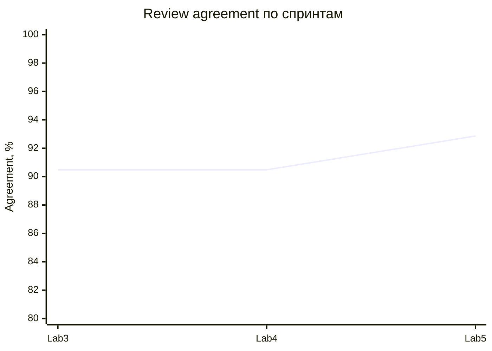

# Финальный отчёт качества Lab 5

## Релиз `v0.5.1`, 19.10.2026

Команда `python tests/evals/run_release_evals.py --release-ref WORKTREE` запускает восемь групп. Объединённое покрытие — **132/132** уникальных golden-кейса, пропусков нет. Двенадцать security-кейсов намеренно проверены и model-, и application-runner; это перекрёстная проверка, а не недостающее покрытие. На теге тот же runner обязан завершиться зелёным.

| Метрика | Lab 3 | Lab 4 / Lab 5 RC | Порог | Итог |
|---|---:|---:|---:|---|
| Schema validity | 100% | 100% | 100% | зелёный |
| Grounding | 100% | 100% | 100% | зелёный |
| Review agreement | 90,48% | 90,48% → **92,86%** | ≥85% | зелёный, +2,38 п.п. в Lab5 |
| Safety guard | не измерен baseline runner | 100% | 100% | зелёный |
| Application E2E | 33 пропущено | 37/37 | 100% | закрыт разрыв |
| Retrieval hit@1 / recall@3 | не было | 100% / 100% | ≥90% / 100% | зелёный |

Источник: `artifacts/evals/lab4-full-results.json`, `application-results.json`, `full-suite-results.json`, `artifacts/experiments/lab4-retrieval-results.json`. Локальная p95 финального model runner (**3 мс**) — скорость deterministic-кода, не Gemini.

Прирост Lab5 получен точечной нормализацией варианта написания с `э`. Поэлементная ablation показывает: полный вариант 92,86%; без aliases 88,10%; без stemming 90,48%; без source precision 90,48%; без contradiction guard 88,10%; raw lexical 71,43%. Три оставшихся расхождения — кандидаты на ручное исправление эталонов: в них ответ совпадает с reference, но метка требует `partially_correct`.

## Ограничения

- Gemini prompt A/B — 20 кейсов и один повтор на `gemini-3.5-flash-lite`; полный релизный gate deterministic.
- Golden dataset в основном synthetic/team-curated, внешняя разметка мала.
- Top-3 retrieval теряет четвёртый релевантный фрагмент.
- Бинарный PDF parser/OCR не входит в **17** текущих security-сценариев: они напрямую вызывают обработчики с текстом, подменяют модель и проверяют отказ анонимному запросу. Это не сквозная загрузка PDF по HTTP и не fuzzing парсера.
- North Star имеет n=1 и пока не подтверждает продуктовую цель статистически.

## Релизный прогон

Финальный тег `v0.5.1` проверен GitHub Actions на коммите `e0ca9b9`: [полный release quality gate завершился success](https://github.com/vstu-sii/kartochki-dlya-povtoreniya-iz-konspekta-4rnb/actions/runs/39221429651). Параллельная [воспроизводимая сборка релиза также success](https://github.com/vstu-sii/kartochki-dlya-povtoreniya-iz-konspekta-4rnb/actions/runs/39221429842). Поэтому quality-gates зелёные именно на неизменяемом релизном теге с поэлементной ablation и UC-профилем.

## Сверка с критериями Lab1

Источник: [исходные критерии успеха](https://github.com/vstu-sii/kartochki-dlya-povtoreniya-iz-konspekta-4rnb/blob/lab1-quality-initiation/docs/quality/success-criteria.md). Текущие автоматические метрики не заменяют исходный способ измерения. Ниже «не подтверждено» означает отсутствие сопоставимого доказательства в этом отчёте, а не доказанный провал продукта.

| Критерий Lab1 | Цель | Доказательство и статус |
|---|---|---|
| Полезность карточек по оценкам пользователей | ≥80% | Не подтверждено; Product должен предоставить число положительных и всех оценок. North Star завершения сессий измеряет другое. |
| Верность тезисов при ручной сверке PDF | ≥75% | Не подтверждено; grounding 100% не заменяет ручную оценку верности тезисов. |
| Разборы без противоречий эталону | ≥90% на 20 разборах | Не подтверждено исходным методом; review agreement 92,86% измеряет совпадение меток. Нужна отдельная сверка 20 разборов. |
| Полнота обязательных пунктов разбора | ≥80% на 20 разборах | Не подтверждено; нужна разметка обязательных пунктов и полноты. |
| Тон | 0 критических, ≤5% мелких нарушений на 20 разборах | Не подтверждено; injection safety не измеряет учебный тон. |
| Генерация от загрузки PDF до готового набора | <60 секунд | Не подтверждено сопоставимым сквозным замером; deterministic p95 3 мс относится к другому контуру. |
| Получение разбора ответа | ≤5–7 секунд | Не подтверждено сквозным замером с реальным провайдером. |
| Стоимость | Бюджет из model-candidates.md | Нужны стоимость сценария и сравнение с исходным бюджетом от AI Engineer; token limiter не доказывает фактическую стоимость. |
| Потерянные формулы | <10% | Не подтверждено; нужны исходное число формул и число потерянных при извлечении. |

Вердикт: автоматические gates на выбранном наборе зелёные; достижение всех исходных целей Lab1 пока не подтверждено. Quality сводит результаты; Product предоставляет пользовательские оценки, AI Engineer — разборы и стоимость, Delivery совместно с AI — сквозные времена. Изменение исходного критерия требует объяснения и ссылки на согласованные требования, а не замены порога задним числом.

## Как различать релизные и локальные доказательства

- Источник результата v0.5.1 — указанный выше Actions run 39221429651 на SHA `e0ca9b9ae0ed80f971c4cc50a4ebd86d0e98079b`; внизу страницы находится артефакт `lab5-quality-v0.5.1` с JSON и логами.
- Закоммиченный на v0.5.1 `artifacts/evals/lab5-release-results.json` исторический: внутри указан `v0.5.0-rc1 / 20c0d0b`. Его нельзя использовать как подтверждение v0.5.1 или переименовывать его метаданные задним числом.
- `--release-ref WORKTREE` означает локального кандидата, даже если проверки зелёные. Обновлённый runner принимает релизное имя только при существующем теге на текущем HEAD и чистом рабочем дереве. Этот фикс появился после v0.5.1 и не входит в старый тег.
- [Поэлементная ablation на релизе](https://github.com/vstu-sii/kartochki-dlya-povtoreniya-iz-konspekta-4rnb/blob/v0.5.1/artifacts/experiments/lab5-ablation-results.json). Наличие отчёта другой роли на интеграционном теге не требует копирования всей её ветки в Quality.
