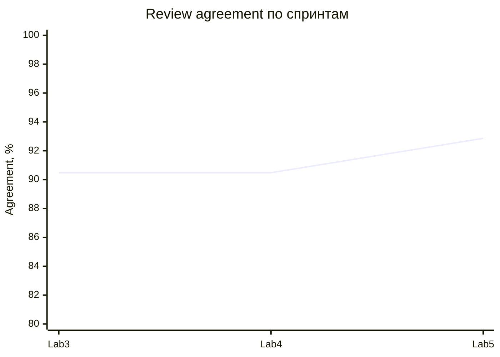

# Финальный отчёт качества Lab 5

## Релиз `v0.5.1`, 19.10.2026

Команда `python tests/evals/run_release_evals.py --release-ref WORKTREE` запускает восемь групп. Объединённое покрытие — **132/132** уникальных golden-кейса, пропусков нет. Двенадцать security-кейсов намеренно проверены и model-, и application-runner; это перекрёстная проверка, а не недостающее покрытие. На теге тот же runner обязан завершиться зелёным.

| Метрика | Lab 3 | Lab 4 / Lab 5 RC | Порог | Итог |
|---|---:|---:|---:|---|
| Schema validity | 100% | 100% | 100% | зелёный |
| Grounding | 100% | 100% | 100% | зелёный |
| Review agreement | 90,48% | 90,48% → **92,86%** | ≥85% | зелёный, +2,38 п.п. в Lab5 |
| Safety guard | не измерен baseline runner | 100% | 100% | зелёный |
| Application E2E | 33 пропущено | 37/37 | 100% | закрыт разрыв |
| Retrieval hit@1 / recall@3 | не было | 100% / 100% | ≥90% / 100% | зелёный |

Источник: `artifacts/evals/lab4-full-results.json`, `application-results.json`, `full-suite-results.json`, `artifacts/experiments/lab4-retrieval-results.json`. Локальная p95 финального model runner (**3 мс**) — скорость deterministic-кода, не Gemini.

Прирост Lab5 получен точечной нормализацией варианта написания с `э`. Поэлементная ablation показывает: полный вариант 92,86%; без aliases 88,10%; без stemming 90,48%; без source precision 90,48%; без contradiction guard 88,10%; raw lexical 71,43%. Три оставшихся расхождения — кандидаты на ручное исправление эталонов: в них ответ совпадает с reference, но метка требует `partially_correct`.

## Ограничения

- Gemini prompt A/B — 20 кейсов и один повтор на `gemini-3.5-flash-lite`; полный релизный gate deterministic.
- Golden dataset в основном synthetic/team-curated, внешняя разметка мала.
- Top-3 retrieval теряет четвёртый релевантный фрагмент.
- Бинарный PDF parser/OCR не входит в **17** текущих security-сценариев: они напрямую вызывают обработчики с текстом, подменяют модель и проверяют отказ анонимному запросу. Это не сквозная загрузка PDF по HTTP и не fuzzing парсера.
- North Star имеет n=1 и пока не подтверждает продуктовую цель статистически.

## Релизный прогон

Финальный тег `v0.5.1` проверен GitHub Actions на коммите `e0ca9b9`: [полный release quality gate завершился success](https://github.com/vstu-sii/kartochki-dlya-povtoreniya-iz-konspekta-4rnb/actions/runs/39221429651). Параллельная [воспроизводимая сборка релиза также success](https://github.com/vstu-sii/kartochki-dlya-povtoreniya-iz-konspekta-4rnb/actions/runs/39221429842). Поэтому quality-gates зелёные именно на неизменяемом релизном теге с поэлементной ablation и UC-профилем.

## Сверка с критериями Lab1

Источник: [исходные критерии успеха](https://github.com/vstu-sii/kartochki-dlya-povtoreniya-iz-konspekta-4rnb/blob/lab1-quality-initiation/docs/quality/success-criteria.md). Текущие автоматические метрики не заменяют исходный способ измерения. Ниже «не подтверждено» означает отсутствие сопоставимого доказательства в этом отчёте, а не доказанный провал продукта.

| Критерий Lab1 | Цель | Доказательство и статус |
|---|---|---|
| Полезность карточек по оценкам пользователей | ≥80% | По передаче Product: **2/3 = 66,67% событий**, цель не достигнута. Включены смена оценки и smoke; это не три независимых пользовательских оценки. [Источники и ограничения](lab5-handoff-review-2026-10-27.md). |
| Верность тезисов при ручной сверке PDF | ≥75% | Не подтверждено; grounding 100% не заменяет ручную оценку верности тезисов. |
| Разборы без противоречий эталону | ≥90% на 20 разборах | Совместное ревью Ткаченко С. А. и Цвилевой В. А.: **16/20 = 80%**, цель не достигнута; [протокол](lab1-ai-evidence-review.md). |
| Полнота обязательных пунктов разбора | ≥80% на 20 разборах | Совместное ревью: **7/20 = 35%**, цель не достигнута; неполные объяснения и ложные пропуски — [протокол](lab1-ai-evidence-review.md). |
| Тон | 0 критических, ≤5% мелких нарушений на 20 разборах | Совместное ревью 20/20: **0 критических и 0 мелких нарушений (0%)**, обе цели по тону достигнуты. |
| Генерация от загрузки PDF до готового набора | <60 секунд | Не подтверждено сопоставимым сквозным замером; deterministic p95 3 мс относится к другому контуру. |
| Получение разбора ответа | ≤5–7 секунд | Не подтверждено сквозным замером с реальным провайдером. |
| Стоимость | Бюджет из model-candidates.md | Нужны стоимость сценария и сравнение с исходным бюджетом от AI Engineer; token limiter не доказывает фактическую стоимость. |
| Потерянные формулы | <10% | Не подтверждено; нужны исходное число формул и число потерянных при извлечении. |

Вердикт: автоматические gates на выбранном наборе зелёные; достижение всех исходных целей Lab1 пока не подтверждено. Quality сводит результаты; Product предоставляет пользовательские оценки, AI Engineer — разборы и стоимость, Delivery совместно с AI — сквозные времена. Изменение исходного критерия требует объяснения и ссылки на согласованные требования, а не замены порога задним числом.

## Как различать релизные и локальные доказательства

- Источник результата v0.5.1 — указанный выше Actions run 39221429651 на SHA `e0ca9b9ae0ed80f971c4cc50a4ebd86d0e98079b`; внизу страницы находится артефакт `lab5-quality-v0.5.1` с JSON и логами.
- Закоммиченный на v0.5.1 `artifacts/evals/lab5-release-results.json` исторический: внутри указан `v0.5.0-rc1 / 20c0d0b`. Его нельзя использовать как подтверждение v0.5.1 или переименовывать его метаданные задним числом.
- `--release-ref WORKTREE` означает локального кандидата, даже если проверки зелёные. Обновлённый runner принимает релизное имя только при существующем теге на текущем HEAD и чистом рабочем дереве. Этот фикс появился после v0.5.1 и не входит в старый тег.
- [Поэлементная ablation на релизе](https://github.com/vstu-sii/kartochki-dlya-povtoreniya-iz-konspekta-4rnb/blob/v0.5.1/artifacts/experiments/lab5-ablation-results.json). Наличие отчёта другой роли на интеграционном теге не требует копирования всей её ветки в Quality.

## Совместимость ролей и оставшиеся условия сдачи — 22.10.2026

Локально проверено объединение Delivery `9f5e815`, AI `a06f73e`, Product `765e2f4`, Quality `92e6655` в отдельной временной копии. После пересоздания конфликтующих результатов восемь групп прошли, покрытие 132/132, unit/integration — 38 тестов. Это deterministic WORKTREE-прогон, не новый релиз и не повторная проверка живого Telegram, Docker или Gemini. Последующие правки документов не меняют эту зафиксированную область проверки.

При объединении AI и Quality конфликтуют восемь генерируемых JSON: `artifacts/evals/{application-results,full-suite-results,lab4-full-results}.json`, `artifacts/experiments/{lab4-algorithm-results,lab4-contract-results,lab4-retrieval-results}.json`, `artifacts/security/{lab4-attacks-after,lab4-attacks-before}.json`. Их нужно получить новым прогоном объединённого кода, а не смешивать отдельные строки разных запусков. В `lab5-release-testing` дополнительно конфликтуют `final-quality-report.md` и `trust-facts.md`: сохранить уточнения Quality и актуальные ссылки на доказательства.

| Открытый пункт | Владелец | Условие закрытия |
|---|---|---|
| Скриншот Grafana | Quality + Delivery | Реальные данные, время, окружение и версия; ссылка в trust-facts.md. Скриншот CI уже есть у Delivery. |
| Критерии Lab1 | Quality + Product + AI + Delivery | Заполнить таблицу выше сопоставимыми измерениями; неподтверждённое не объявлять достигнутым. |
| Формулировка слайда безопасности | Product | В demo-narrative.md заменить «17/17 заблокированы» на состав 17 успешных проверок из trust-facts.md. |
| Документация и модель | AI | Исправить ml/prompts/ на ml/prompts_v2/ в ml-documentation.md; явно связать фактическую модель окружения с измерениями. A/B gemini-3.5-flash-lite не подтверждает качество настроенной по умолчанию gemini-3.8-flash. |
| Новый общий релиз | Delivery + Quality | Объединить роли, пересоздать результаты, зафиксировать новый тег, получить зелёные CI и обновить SHA/ссылки. Не перемещать v0.5.1. |

Изменения Quality после v0.5.1 не входят в старый тег. Закрытие этой таблицы требует перечисленных доказательств; исправление текста само по себе не заменяет измерение или выпуск релиза.

## Пакет от AI Engineer — 26.10.2026

Добавлены [методика](lab1-ai-evidence.md), [JSON с 20 разборами](../../artifacts/evals/lab1-ai-quality-evidence.json) и [проверка пакета](lab1-ai-evidence-review.md). Технический аудит подтвердил хеш dataset, исходные поля и повторяемость устойчивых результатов в 20/20 строках. Это отдельный поднабор; полный review agreement остаётся 92,86%.

Совместная человеческая разметка завершена 20/20: отсутствие противоречий **80%**, полнота **35%**, критические нарушения **0**, мелкие **0%**. Ревью выполнено, но две цели качества не достигнуты; [решения проверяющих и уточнение FIFO](lab1-ai-evidence-review.md). Полезность дополнительно получена в передаче Product 27.10: 2/3 событий, 66,67%, цель не достигнута. Исходные PDF, проверка формул, фактическая стоимость и сквозное время пока не представлены. [Оставшиеся действия Quality](lab5-remaining-checklist.md).

Ручные результаты получены 26.10.2026 на сохранённом deterministic-поднаборе после релиза v0.5.1. Это не повторный live-прогон и не изменение автоматического agreement. Для улучшения результата AI нужно исправить ложные пропуски и содержательность feedback/missing_points, затем предоставить новый снимок для отдельной повторной оценки. Текущие подтверждённые оценки сохраняются.

## Сводка передачи трёх ролей — 27.10.2026

[Подробная сверка и доказательства](lab5-handoff-review-2026-10-27.md). Полезность по переданным Product событиям — 66,67% против цели 80%, с ограничениями смешанной малой выборки. Provider B пересчитан по исходным 20 значениям: p50 6227,845 мс, p95 6569,36 мс; отдельно review p95 6427,89 мс. Это не E2E-время из критериев Lab1.

Полученный AI v4 воспроизводит 20/20 технических результатов и исправляет баг жёсткого диска, но содержит открытые Q5-AFTER-001…003; ручная разметка нового пакета не выполнена. До неё старые 80% / 35% остаются последними подтверждёнными ручными результатами.

Delivery публикует отдельную пробу version=lab5 после деплоя, однако окно 30/30 с p95 2231,14 мс относится к version=lab4. Тег v0.5.2-demo не включает новую AI-реализацию и не заменяет проверенный общий release quality gate. Grafana screenshot, исходные PDF и полноценные E2E-замеры пока отсутствуют. Итог: отчёт актуализирован, но все первоначальные цели и условия сдачи не подтверждены.
